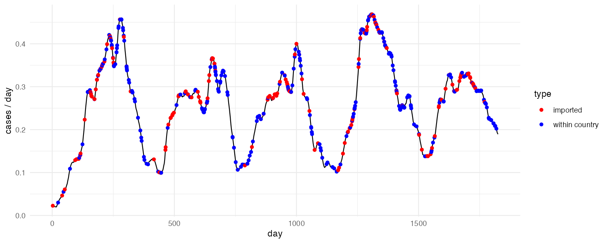
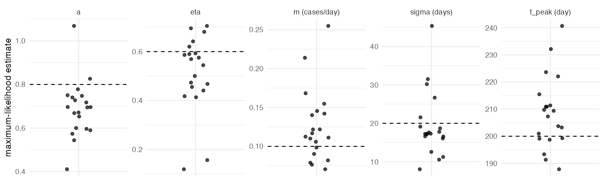

# Hawkes processes for imported vs local malaria cases

Code behind the blog post [*Hawkes processes in epidemiology*](https://timj-wood.github.io/posts/hawkes-processes/): simulate a near-elimination malaria outbreak as a Hawkes process, fit the model back to the case times alone, and ask it which cases were imported and which were locally acquired.

The model, simulator, likelihood and analytic gradient come from the [`epihawkes`](https://github.com/mrc-ide/epihawkes) R package released with Unwin *et al.* (2021). This repository adds a parameter translation, a family-tree simulator that records who infected whom (so the model's answers can be marked), the imported/local classification step, and a replicate experiment on parameter recovery.

## The model

Conditional intensity $\lambda^{\ast}(t) = \mu(t) + \sum_{t_i < t} \phi(t - t_i)$ with

- a seasonal background (imported cases) $\mu(t) = m\,(1 + a\cos(2\pi(t - t_{\text{peak}})/365))$
- a delayed Rayleigh kernel (local transmission) $\phi(u) = \eta\, g(u)$: zero for 15 days, then a Rayleigh hump with spread $\sigma$; $\eta$ is the branching ratio / case reproduction number $R_c$.

`epihawkes` writes the same thing as `alpha * (u - delay) * exp(-delta (u - delay)^2 / 2)` and `A + M cos(wt) + N sin(wt)`; `hawkes_malaria.R` does the translation ($\eta = \alpha/\delta$, $\sigma^2 = 1/\delta$, $A = m$, $(M, N) = ma(\cos, \sin)(\omega t_{\text{peak}})$).

## Files

| File | What it does |
|---|---|
| `hawkes_malaria.R` | Simulate five years of cases (both by `epihawkes::hawkes_simulation()` and by a family tree), fit by maximum likelihood with `epihawkes::neg_log_likelihood()` + `ray_derivatives()`, classify cases, draw the figures. ~3 min. |
| `replicates.R` | Repeat simulate-and-fit on 20 datasets to see how well the parameters are recovered. ~15 min on 2 cores. |
| `rep_plot.R` | Plot the replicate estimates against the truth. |
| `results/replicates.csv` | Output of `replicates.R` (so you don't have to rerun it). |
| `figures/` | The figures used in the post. |

## Running it

```r
install.packages(c("remotes", "ggplot2"))
remotes::install_github("mrc-ide/epihawkes")

source("hawkes_malaria.R")   # figures/simulated_outbreak.png, kernel.png, classification.png
source("replicates.R")       # results/replicates.csv   (slow; optional)
source("rep_plot.R")         # figures/replicates.png
```

Run from the repository root so the relative paths resolve. `replicates.R` uses `parallel::mclapply`, which does not fork on Windows; swap in `lapply` there.

## What it shows



With $\eta = 0.6$ the simulation gives ~60% local cases, as it should. Fitting recovers the parameters, but noisily: across 20 replicate datasets the estimate of $\eta$ ranged from 0.1 to 0.7, with the background rate pulled up whenever $\eta$ was pulled down. The two trade off against each other and ~450 cases do not pin them both down.



Per-case classification is weak (the estimated P(imported) distributions for truly imported and truly local cases overlap heavily), while the aggregate picture is reasonable. Timing tells you how much transmission there is, not which case came from where, which is why Unwin *et al.* kept travel histories as a check.

## References

- Unwin, H. J. T., Routledge, I., Flaxman, S., Rizoiu, M.-A., Lai, S., Cohen, J., Weiss, D. J., Mishra, S. & Bhatt, S. (2021). Using Hawkes Processes to model imported and local malaria cases in near-elimination settings. *PLoS Computational Biology* 17(4): e1008830. https://doi.org/10.1371/journal.pcbi.1008830
- `epihawkes`: https://github.com/mrc-ide/epihawkes
- Laub, P. J., Taimre, T. & Pollett, P. K. (2015). Hawkes processes. https://arxiv.org/abs/1507.02822
